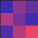

# heightmap-rgb-gen

CLI tool that turns a heightmap (a text file of numbers) into a PNG, coloring each value on a gradient between two colors.

[GitHub](https://github.com/PaperPesto/heightmap-rgb-gen) · [npm](https://www.npmjs.com/package/heightmap-rgb-gen)

## Requirements

Node.js 18 or later.

## Installation

Run it without installing:

```bash
npx heightmap-rgb-gen
```

or install it globally:

```bash
npm install -g heightmap-rgb-gen
```

## Usage

```bash
heightmap-rgb-gen [inputFile] [width] [height] [fromColor] [toColor] [midPoints] [outputFile] [verbose]
```

All arguments are positional and optional. To set one, also pass all the ones before it.

| Argument     | Default             | Description                                                                 |
| ------------ | ------------------- | --------------------------------------------------------------------------- |
| `inputFile`  | `heightmap`         | Input file, relative to the current directory or absolute.                  |
| `width`      | `⌊√n⌋`              | Image width in pixels (`n` is the number of values in the input).           |
| `height`     | `⌊n / width⌋`       | Image height in pixels. `width × height` must equal `n`.                    |
| `fromColor`  | `#3F2CAF`           | Color of the lowest value. Hex, with or without `#`, 3 or 6 digits.         |
| `toColor`    | `#e9446a`           | Color of the highest value.                                                 |
| `midPoints`  | `10`                | Number of colors in the gradient (at least 2).                              |
| `outputFile` | `<inputFile>.png`   | Output PNG path.                                                            |
| `verbose`    | off                 | Any value other than `false` or `0` logs every pixel.                       |

Width and height are only used when both are given; otherwise both defaults apply (a square image when `n` is a perfect square).

### Input format

Numbers (integers or decimals, negatives allowed) separated by commas, spaces or newlines:

```text
0,4,2
6,3,0
1,6,8
```

Values are read row by row, left to right. The lowest value gets `fromColor`, the highest gets `toColor`, and everything in between falls into one of the `midPoints` gradient steps.

## Examples

A file named `heightmap` containing

```text
0,4,2,6,3,0,1,6,8
```

and the command

```bash
npx heightmap-rgb-gen
```

produce `heightmap.png`, a 3×3 image (enlarged here):



With a file `heightmap.txt` of 100 values:

```bash
npx heightmap-rgb-gen heightmap.txt 10 10 faf450 0254ff 10
```

creates `heightmap.txt.png`, 10×10 pixels, using 10 colors from `#faf450` to `#0254ff`.

## License

[ISC](LICENSE)
